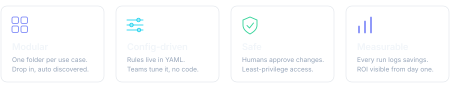
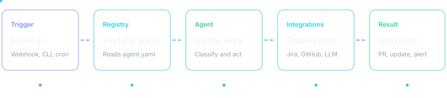

<div align="center">
  
  <p><a href="https://prth1234.github.io/agent-for-automation/">Interactive site and agent explorer</a></p>
</div>

<div align="center">
  
</div>

<br/>

## The idea

Every agile team have many repetitive work: triaging tickets, extracting data from documents, drafting reports, answering the same questions. Most automations get built once, live in one person's repo, and never get reused.

**AFA turns each automation into a self-contained agent module that you can install, configure, and run.**

<div align="center">
  
</div>

## How it works

<div align="center">
  
</div>

A trigger arrives from a webhook, the CLI, or a schedule. The registry finds the right agent by reading its `agent.yaml`. The agent executes through shared integrations, and the result lands as a pull request, a ticket update, or a notification.

## How a ticket becomes a pull request

A customer raises `SQ-123`: *"Please onboard org 4821 to Genie."* The agent handles it end to end, and a human reviews the pull request before anything merges.

<div align="center">
  
</div>

<div align="center">
  
</div>

Turnaround drops from about a day to minutes.

<details>
<summary><b>Step-by-step breakdown</b></summary>

<br/>

1. The Jira webhook hits `POST /webhooks/jira`.
2. The registry loads the `support_ticket` agent.
3. The classifier labels the ticket as Genie onboarding, bug investigation, or unknown.
4. The handler finds the repo in `config/repos.yaml`, edits Terraform, and opens a pull request.
5. Jira is updated with the PR link and the team is notified.
6. The ticket state is stored so it is never processed twice.

</details>

## Quick start

```bash
afa list                                # browse available agents
afa info support_ticket                 # inputs, permissions and config
afa run support_ticket --ticket SQ-123  # run on a live ticket
afa serve                               # start the webhook server
```

## Agent marketplace

<div align="center">
  
</div>

| Agent | Category | Status | Triggers | Inputs | Output | Est. time saved |
| :--- | :--- | :--- | :--- | :--- | :--- | :--- |
| [`support_ticket`](src/agents_for_automation/agents/support_ticket/README.md) | `engineering` | `stable` | `webhook:jira`, `cli` | `--ticket`, `--json` | Pull request, Jira comment, notification | ~30m / run |
| [`weekly_digest`](src/agents_for_automation/agents/weekly_digest/README.md) | `reporting` | `beta` | `schedule:weekly`, `cli` | `--team`, `--json` | Markdown digest via SES / Teams | ~20m / run |
| [`invoice_extraction`](src/agents_for_automation/agents/invoice_extraction/README.md) | `parsing` | `beta` | `cli`, `webhook:invoice` | `--json`, `--text` | Validated accounting JSON payload | ~25m / run |
| [`doc_generator`](src/agents_for_automation/agents/doc_generator/README.md) | `templates` | `beta` | `cli`, `webhook:doc` | `--template`, `--json` | Rendered Markdown document | ~35m / run |
| [`compliance_check`](src/agents_for_automation/agents/compliance_check/README.md) | `validation` | `beta` | `cli`, `webhook:compliance` | `--ruleset`, `--json` | Compliance report & issue alert | ~30m / run |
| [`slack_qa`](src/agents_for_automation/agents/slack_qa/README.md) | `chatops` | `beta` | `cli`, `webhook:slack` | `--question`, `--json` | Cited answer & confidence score | ~10m / run |

<details>
<summary><b>Detailed agent reference</b></summary>

<br/>

- **`support_ticket`** ([README](src/agents_for_automation/agents/support_ticket/README.md)) — Triages Jira Support Question (`SQ`) tickets by classifying them into Genie onboarding, bug investigation, or unknown. Routes to the target repository via `config/repos.yaml`, edits Terraform or investigates code with `ripgrep` + Bedrock, opens a GitHub PR, updates Jira, notifies via SES / Teams, and records state in `.afa_state.json` to prevent duplicate runs.
- **`weekly_digest`** ([README](src/agents_for_automation/agents/weekly_digest/README.md)) — Aggregates processed tickets and pull requests for a team into a structured Markdown digest (`# Weekly Digest — <team>`) and dispatches it through `NotifierConnector` (SES / Teams).
- **`invoice_extraction`** ([README](src/agents_for_automation/agents/invoice_extraction/README.md)) — Parses structured JSON or raw invoice text for `vendor`, `invoice_number`, `date`, `currency`, `subtotal`, `tax`, `total_amount`, and `line_items`. Validates required fields and line-item/subtotal/tax arithmetic, returning `VALIDATION_FAILED` on mismatches or a normalized accounting payload on success.
- **`doc_generator`** ([README](src/agents_for_automation/agents/doc_generator/README.md)) — Renders structured Markdown documents from built-in templates (`board_resolution`, `offer_letter`, `compliance_filing`) or custom `template_text`. Validates all `{placeholder}` fields before rendering and returns `NEEDS_INFO` with `missing_fields` if any are absent.
- **`compliance_check`** ([README](src/agents_for_automation/agents/compliance_check/README.md)) — Audits submitted document lists against built-in rulesets (`vendor_onboarding`, `release_readiness`) or custom `required_documents` for missing documents, inconsistent entity names/IDs, and expired dates. Returns `ISSUES_FOUND` and notifies via `NotifierConnector` when checks fail.
- **`slack_qa`** ([README](src/agents_for_automation/agents/slack_qa/README.md)) — Ranks sections across internal SOPs (built-in defaults or custom `sops` list) using keyword overlap and returns the top 3 matches with exact `sources` citations and a `confidence` score, or an escalation message to `#ops-help` / on-call if no SOP matches.

</details>

## Build your own agent

```bash
# 1. Copy the template
cp -r src/agents_for_automation/agents/_template \
      src/agents_for_automation/agents/my_agent

# 2. Describe it in agent.yaml and implement it in agent.py

# 3. Confirm it is discovered
afa list
```

<details>
<summary><b>Project structure</b></summary>

<br/>

```text
src/agents_for_automation/
  core/            # base classes, registry, manifest schema
  integrations/    # Jira, GitHub, LLM, email, Slack and Teams
  agents/
    support_ticket/
    weekly_digest/
    invoice_extraction/
    doc_generator/
    compliance_check/
    slack_qa/
    _template/
```

</details>

<details>
<summary><b>Development &amp; testing</b></summary>

<br/>

```bash
# Run test suite
pytest

# Lint with Ruff
ruff check .
```

</details>

## Principles

- **Human in the loop.** Agents propose, people approve.
- **Measurable.** Every run logs time saved and duration, so ROI is visible.
- **Safe by default.** Least-privilege credentials, retry and step caps, no silent failures.
- **Handover-friendly.** Rules and templates live in config, not code.

<br/>

<div align="center">
  
</div>
