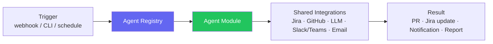
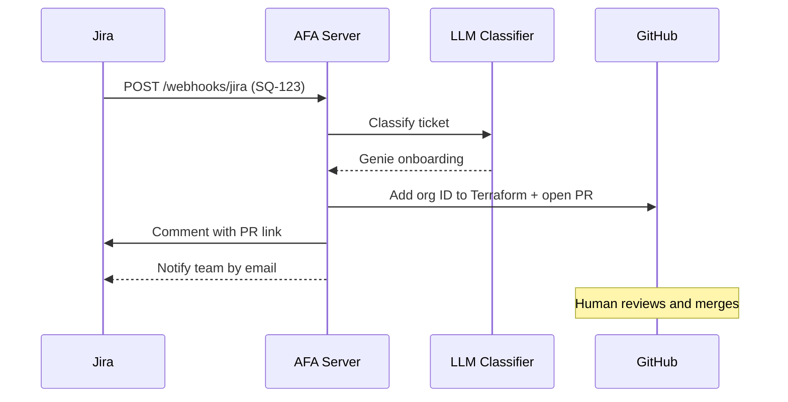

<div align="center">


<a href="https://github.com/YOUR_USERNAME/YOUR_REPO">
  
</a>


</div>

---

## ⚡ See it in action

<div align="center">
  
</div>

> A Jira ticket comes in, and a reviewed pull request comes out. No human typed a line of code.

## 💡 The idea

Every team has repetitive work: triaging tickets, extracting data from documents, drafting reports, answering the same questions. Most automations get built once, live in one person's repo, and never get reused.

**AFA turns each automation into a self-contained agent module you can install, configure and run.**

| 🧩 Modular | ⚙️ Config-driven | 🔒 Safe | 📈 Measurable |
|---|---|---|---|
| One folder per use case | Non-technical teams tune rules in YAML | Humans approve, least-privilege access | Every run logs time saved |

## 🔄 How it works



## 🎫 Example: Support Ticket Agent

A customer raises `SQ-123`: *"Please onboard org 4821 to Genie."*



**Before:** about a day of manual work. **After:** minutes, with a human still approving the PR.

<details>
<summary><b>🔍 Step-by-step breakdown (click to expand)</b></summary>

1. The Jira webhook hits `POST /webhooks/jira`.
2. The registry loads the `support_ticket` agent.
3. The classifier labels it **Genie onboarding** (others: *Bug investigation*, *Unknown*).
4. The handler finds the repo in `config/repos.yaml`, edits Terraform, and opens a PR.
5. Jira is updated with the PR link and the team gets an email.
6. Ticket state is stored so it is never processed twice.

</details>

## 🚀 Quick start

```bash
afa list                              # browse available agents
afa info support_ticket               # inputs, permissions, config
afa run support_ticket --ticket SQ-123
afa run support_ticket --json src/agents_for_automation/agents/support_ticket/examples/sq_32775.json
afa serve                             # start the webhook server
```

## 🛒 Agent marketplace

| Agent | Status | What it automates |
|---|---|---|
| 🎫 `support_ticket` |  | Triage Jira tickets, open PRs for fixes and onboarding |
| 📰 `weekly_digest` |  | Summarise tickets, PRs or metrics into a digest |
| 🧾 `invoice_extraction` |  | Read PDFs, validate fields, push to accounting |
| 📄 `doc_generator` |  | Draft resolutions, letters and filings from templates |
| ✅ `compliance_check` |  | Flag missing or inconsistent documents |
| 💬 `slack_qa` |  | Answer staff questions from internal SOPs, with sources |

## 🧱 Build your own agent in 3 steps

```bash
# 1. Copy the template
cp -r src/agents_for_automation/agents/_template \
      src/agents_for_automation/agents/my_agent

# 2. Edit agent.yaml (what it does) and agent.py (how it does it)

# 3. Confirm it is discovered
afa list
```

<details>
<summary><b>📁 Project structure</b></summary>

```
src/agents_for_automation/
├── core/            # base classes, registry, manifest schema
├── integrations/    # Jira, GitHub, LLM, email, Slack/Teams
└── agents/
    ├── support_ticket/
    ├── weekly_digest/
    └── _template/
```

</details>

## 🧭 Principles

- 🙋 **Human in the loop:** agents propose, people approve.
- 📊 **Measurable:** every run logs time saved and duration, so ROI is visible.
- 🛡️ **Safe by default:** least-privilege credentials, retry and step caps, no silent failures.
- 🤝 **Handover-friendly:** rules and templates live in config, not code.

<div align="center">


</div>